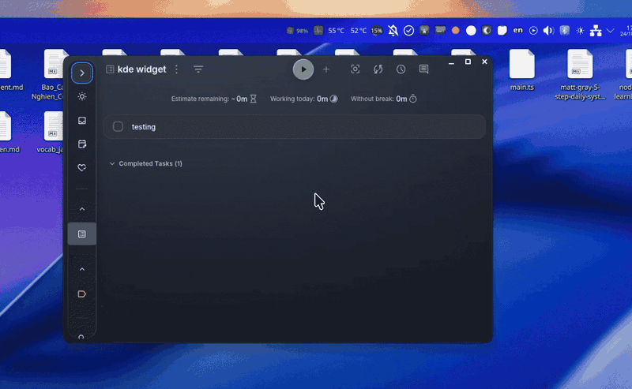

# Super Productivity Pomodoro Widget for KDE Plasma 6

A lightweight, distraction-free KDE Plasma 6 widget (Plasmoid) to display and track Pomodoro sessions directly on your KDE panel, integrated with [Super Productivity](https://github.com/johannesjo/super-productivity).



---

## Features

- **Direct Panel Integration:** Displays remaining time (`mm:ss`), current session type (Focusing, Short Break, Long Break), and the active task title directly on the KDE panel.
- **Auto-Hide (Zero Clutter):** Automatically hides itself from the panel when idle or when Super Productivity is closed.
- **Smart Resource Management:**
  - Detects whether Super Productivity is running before sending any network requests.
  - Zero HTTP requests are sent when the app is closed.
  - Adaptive polling: polls every second during active Pomodoro sessions, and relaxes interval when idle.
- **Compact Popup:** Click the widget to see the cycle count (`#Cycle`), a large countdown timer, and a one-click **Stop Task** button.
- **Zero App Modifications:** Connects seamlessly via Super Productivity's built-in Local REST API.

---

## Requirements & Dependencies

- **KDE Plasma 6**
- **plasma5support** (`plasma6-plasma5support` / `plasma-plasma5support` - provides `P5Support.DataSource` executable engine)
- **Super Productivity** (Desktop version with Local REST API enabled)

---

## Getting Started

### 1. Enable Local REST API in Super Productivity

1. Open **Super Productivity**.
2. Go to **Settings** -> **Misc Settings**.
3. Toggle on **Enable local REST API** (default port: `3876`).
   > The auth token is automatically generated and stored at `~/.config/superProductivity/local-rest-api-token`.

### 2. Install the Widget

Clone this repository and run the install script:

```bash
git clone https://github.com/Mintori09/super-productivity-plasma-widget.git
cd super-productivity-plasma-widget
./install.sh
```

Or manually link the plasmoid directory:

```bash
mkdir -p ~/.local/share/plasma/plasmoids
ln -sfn "$(pwd)/org.kde.plasma.superproductivity" ~/.local/share/plasma/plasmoids/org.kde.plasma.superproductivity
systemctl --user restart plasma-plasmashell.service
```

### 3. Add to Panel

1. Right-click on your KDE Panel -> select **Enter Edit Mode**.
2. Click **Add Widgets...**
3. Search for **Super Productivity Pomodoro**.
4. Drag and drop it onto your preferred position on the panel.

---

## License

MIT
